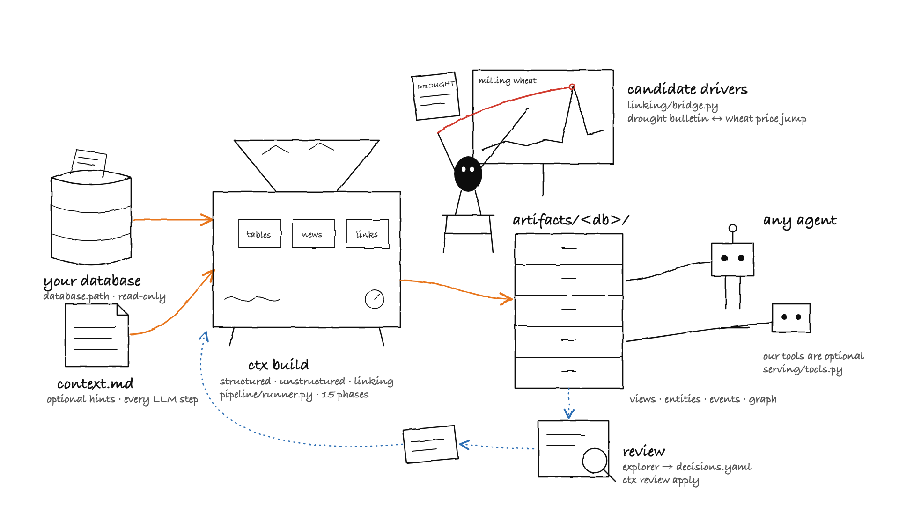

# Context Layer

Point it at a database of numbers and text (for example prices and news) and it builds context that any agent can use: semantic SQL views, an entity catalog, events extracted from the text, a knowledge graph, and the news that may explain each move in the numbers. Everything is written as plain files. Nothing about your dataset is hard-coded, and everything runs locally with [Ollama](https://ollama.com).



*Your database goes in; files, SQL views and optional tools come out, ready for any agent.*

- Setup, every command, review flow, troubleshooting: [docs/RUNNING.md](docs/RUNNING.md)
- Every output file, with a sample and how to use it: [docs/CONTEXT_FILES.md](docs/CONTEXT_FILES.md)

## Quick start

You need Python 3.12 and Ollama.

```bash
uv pip install -e ".[dev]"            # or: pip install -e ".[dev]"
ollama pull qwen3.8:27b                # the LLM
ollama pull qwen3-embedding:0.6b      # the embeddings
ollama serve                           # leave running in another terminal
ctx check-llm                          # one tiny LLM call

python examples/make_example_db.py    # writes data/example.duckdb and examples/questions.csv
ctx build                             # or: ctx build --human-review
ctx show                              # the context explorer page
ctx ask "Why did the milling wheat price jump in May 2025?"
```

The example database is synthetic: made-up crop prices and farm bulletins, with one planted story (a drought, then a price jump).

## How it works

The build runs 15 phases in three groups. Each phase writes a file to `artifacts/<database>/`, and the next phase reads it. A rebuild only reruns phases whose inputs changed.

| Group | Phase | What it does | Uses the LLM? |
|---|---|---|---|
| Structured | `profile` | Column statistics (types, nulls, distinct counts, samples) | No |
| Structured | `roles` | Gives every column a generic role (entity, measure, date, currency, text...) | Yes |
| Structured | `ontology` | Names the kinds of things in the data and how they relate | Yes |
| Structured | `catalog` | One entry per product, series or place, with aliases and parents | Data + small LLM steps |
| Structured | `semantic` | Rules for using each table: measures, time grains, units, actual vs projected | Small LLM steps |
| Structured | `views` | Read-only `sem_*` SQL views | No |
| Structured | `moves` | Finds unusually large changes in each series | No |
| Unstructured | `documents` | Builds one clean record per article | No |
| Unstructured | `index` | Cuts articles into chunks, adds embeddings and a keyword index | No (local embeddings) |
| Unstructured | `event-types` | Proposes the kinds of events the news reports | Yes |
| Unstructured | `extraction` | Extracts events with the exact supporting sentence | Yes |
| Unstructured | `resolve` | Matches names in the text to catalog entries | LLM judge for hard cases |
| Unstructured | `dedupe` | Merges articles that report the same event | No (local embeddings) |
| Unstructured | `graph` | Builds the knowledge graph, every edge with its evidence | No |
| Linking | `links` | Finds the events that may explain each move | No |

There are two optional **review points**, after `roles` and after `event-types`. With `ctx build --human-review` the build pauses there so a person can check and correct ([review loop](#review-loop)).

### One example, end to end

In the example data, a bulletin dated 25 April 2025 says:

> Drought has cut milling wheat supply in the Great Plains by about one fifth, the steepest shortfall in a decade.

1. **Extraction** turns the sentence into an event, keeping the exact quote: a `supply_disruption` that affects the `price` of "Wheat (milling)", direction `up`.
2. **Resolve** matches "Wheat (milling)" to the catalog entry `crop:milling_wheat` (the milling wheat series).
3. **Moves** finds that the milling wheat price rose 14.5% on 5 May 2025.
4. **Links** records the event as a candidate driver of that move (10 days earlier).
5. **`explain_move`** returns the news first, then the numbers:

```json
{
  "drivers": [{"summary": "Drought cuts the Great Plains milling wheat crop.",
               "aspect": "price", "direction": "up", "lag_days": 10,
               "quote": "Drought has cut milling wheat supply in the Great Plains by about one fifth, ..."}],
  "moves": [{"date": "2025-05-05", "prev_value": 300.59, "value": 344.25, "change_pct": 14.5}]
}
```

Drivers are candidates to read, not proof of cause.

## Use your own data

1. Set `database.path` in `config/settings.yaml` to your DuckDB file. Output goes to `artifacts/<database file stem>/`.
2. Optional: add `sources/<database file stem>/context.md` with anything the data cannot tell the build. Use [`examples/context.md`](examples/context.md) as a template. Put `<table>.context.md` next to it for one table. Every LLM step reads it. Optional headings (`## Columns`, `## Names`, `## Currencies`, `## News`) let each step read only the part it needs.
3. Optional, for evaluation: make a CSV of questions, set `eval.questions_csv` and `eval.question_column`, and list your own reference systems in `eval.baselines` (each with a name and optional SQL, answer and time columns). Details are in [RUNNING.md](docs/RUNNING.md#using-your-own-data).

## Review loop

Without `--human-review` a build runs straight through. With it, you can check and correct the results:

1. Run `ctx build --human-review`. It pauses after `roles`, and again after `event-types`.
2. Open the explorer (`ctx show`) and click **correct**, **wrong** or **fix** on the items you care about.
3. Click **Export decisions** and save the file as `review/decisions.yaml`.
4. Run `ctx review apply` (or `ctx build --continue` while paused). Only what your decisions affect is rerun.

Decisions are kept, so your fixes survive every rebuild. More in [RUNNING.md](docs/RUNNING.md#review-flow).

## What you get

The output is plain files in `artifacts/<database>/` plus read-only SQL views. You can load them into your own SQL, graph, search or LLM setup. Our tools (`get_context`, `query_metric`, `search_docs`, `graph_explore`, `explain_move` and others) are optional: a thin reference layer built on these files.

| You want | File | How to use it |
|---|---|---|
| Correct SQL over the numbers | `semantic.yaml`, `structured/views.sql` | [Query the views](docs/CONTEXT_FILES.md#1-query-the-views-with-sql) |
| Products, places and their other names | `entities.yaml` | [entities.yaml](docs/CONTEXT_FILES.md#entitiesyaml) |
| Unusual price changes | `structured/moves.jsonl` | [moves](docs/CONTEXT_FILES.md#structuredmovesjsonl) |
| Clean articles and your own search | `docs/documents.jsonl`, `docs/chunks.parquet`, `docs/fts.duckdb` | [Document search](docs/CONTEXT_FILES.md#3-your-own-document-search) |
| Events from the news, with quotes | `docs/events.jsonl` | [events](docs/CONTEXT_FILES.md#docseventsjsonl) |
| A knowledge graph with evidence | `graph/*.jsonl`, `links/*.jsonl` | [Load the graph](docs/CONTEXT_FILES.md#2-load-the-graph) |
| Why a price moved | `links/candidate_drivers.jsonl` | [Drivers to an LLM](docs/CONTEXT_FILES.md#4-feed-a-price-change-and-its-drivers-to-any-llm) |
| Our tools and what each reads | | [Our tools](docs/CONTEXT_FILES.md#our-tools-optional) |

## Evaluation

The evaluation measures how well a reference agent answers questions using the context layer, and compares it with your own baseline systems when you supply them. It reports wins, losses and ties by question category, how close number answers are to the reference result, whether answers are correct, and whether the cited sources back them up. The agent is a rough reference and the judge is the same local model, so treat the results as a guide, especially on small question sets.

```bash
ctx eval prepare                       # categorise questions, run baseline SQL
ctx eval run --sample 15             # answer and score
ctx eval report                        # writes eval/report.md
```

Options and details: [RUNNING.md](docs/RUNNING.md#commands).

## Project layout

Code is in `src/ctxlayer/`:

- `common/`: settings, database access, LLM and embeddings clients, roles, catalog, review decisions
- `structured/`: profile, semantic layer, SQL views, moves and metric tools
- `unstructured/`: documents, chunks, search, event extraction, deduplication, graph
- `linking/`: candidate drivers and the `explain_move` bridge
- `pipeline/`: phase order, staleness checks, build runner and review pauses
- `serving/`: context explorer page, tools offered to agents
- `reference_agent/`: the reference agent and its guardrails
- `evaluation/`: question categories, scoring, judges and the report

Other folders: `config/` (settings), `examples/` (example data and questions), `docs/`, `tests/`.

## Tests

```bash
pytest -q
```

Tests marked `live` need a running Ollama server and `slow` ones need large data; both are skipped by default. Run them with `pytest -m live`.

## License

MIT — see [LICENSE](LICENSE).
